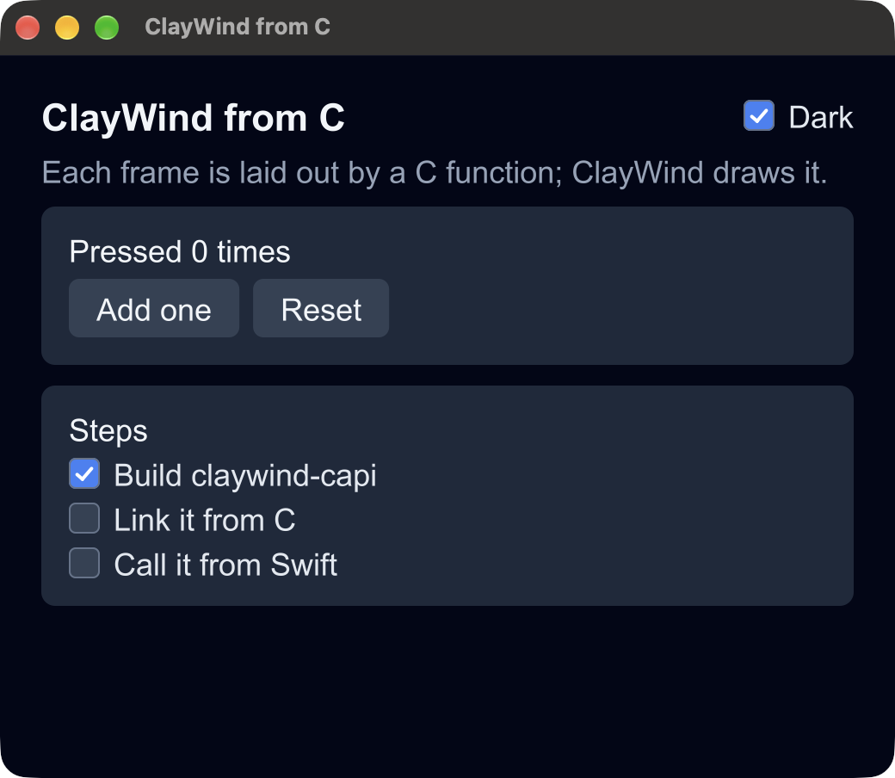

# claywind-capi: ClayWind for C

ClayWind's C API, for programs in C and in languages that call C: Swift (`bindings/swift`), Rust
(`bindings/rust`) and Kotlin (`bindings/kotlin`, through JNI). It is the first step of the roadmap's bindings (P6). The C API is `include/claywind.h`; `examples/counter.c` uses all of it.

```sh
cd claywind-capi
./examples/build.sh   # ceesafec build --emit lib, then the example compiled and linked
./out/counter
```



## How it works

A host calls `claywind_run` with a frame function. ClayWind opens a window, and for each frame calls that function
with a `claywind_frame`. The function lays out the whole window from the program's state: columns, rows, panels,
labels, buttons, checkboxes and text fields. ClayWind then lays the frame out, draws it and waits for input.

The calls are recorded and replayed. ClayWind's `Ui` borrows its memory, and CeeSafe gives C no pointer to a value
that holds loans. So the frame function's calls are recorded into a `Frame` of plain data (`src/frame.cee`), and
ClayWind replays them into the `Ui` when the function returns. A consequence for the host is that a control's result
arrives in the next frame. A button is true in the frame after it was pressed, and a checkbox's new state and a text
field's new text arrive the same way. ClayWind asks for that frame at once, and for one more after it, so what the host
changed in answer shows even where the frame lays it out before the control (a count above its button). The delay
is about one screen refresh.

A text field's text stays in the host's buffer (`claywind_text_field`: the buffer, its capacity and the text's
length). ClayWind keeps the caret and the selection, and a copy of the text it edits; when the user changes the text,
the next call writes it into the buffer, cut at a character to fit, and returns true. A host may also change the
buffer itself: the field then shows the host's text.
`CEESAFE-FINDINGS.md` Q1 records the gap.

## Linking

`ceesafec build --emit lib` writes `out/claywind_capi.a`, which holds CeeSafe's runtime, and `out/ceesafe/embed.h`.
A host:

1. includes `claywind.h` and `ceesafe/embed.h` (`-Iinclude -Iout`);
2. calls `ceesafe_init` once with a config whose `size` is `sizeof(ceesafe_config)` (NULL is refused), on the thread
   that will run the window: the main thread on macOS;
3. links `out/claywind_capi.a`. On macOS it also links `-framework AppKit -framework QuartzCore -framework CoreText
   -framework CoreGraphics`.

## Status

- Checked on macOS: the example builds, opens its window and draws it; with real mouse and key events, a click in
  the name field put the caret at its end, typed text reached the C program's buffer and its greeting, and one click
  on Add one after typing showed the new count. `claywind-tests/tests/capi_test.cee` drives recorded frames with a
  scripted platform: a button press and a checkbox's changes reach the host's next frame, once; a field's typed text
  reaches the host's buffer once, the host's own change stands, and text past the buffer is cut at a character.
- Linux: `examples/build.sh` has a link line, but it has not been run. Windows: no build script yet.
- Swift: `bindings/swift`, a Swift package over this header with the example in Swift (its README).
- Rust: `bindings/rust`, a crate over this header with the example in Rust (its README).
- Kotlin: `bindings/kotlin`, JNI over this header with the example in Kotlin (its README).
- iOS and Android: the Swift binding on the iOS simulator (`bindings/swift/build-ios-simulator.sh`) and the Kotlin
  binding as an Android app (`bindings/kotlin/build-android.sh`), with CeeSafe 0.86.0's host windows (its ADR 0200).
- Next: the bindings on an iPhone and an Android phone; Linux and Windows machines.
